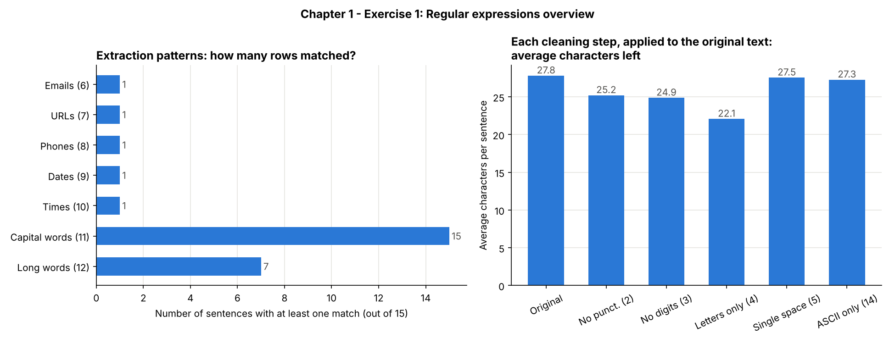

# Chapter 1 – Exercise 1: Regular Expressions

[⬅ Back to the chapter](../README.md) · [🏠 Main page](../../README.md)

📄 **Exercise sheet:** [Exercise_1-Regular Expressions.docx](Exercise_1-Regular%20Expressions.docx)

## Goal

Clean a small dataset of 15 sentences and extract information from it (e-mails, URLs, phone numbers, dates…) with regular expressions and the pandas `.str` methods.

## Key ideas (for a junior)

* **Regular expression (regex)** – a small pattern language that describes *what text looks like*. `\d{4}-\d{2}-\d{2}` = "4 digits, dash, 2 digits, dash, 2 digits" = a date.
* **Raw strings** – always write `r"\d+"`, otherwise Python eats the backslashes.
* **`.str.replace` / `.str.extract` / `.str.findall`** – replace, get the *first* match, get *all* matches (a list).
* **Character classes** – `\w` word character, `\s` whitespace, `[^...]` "anything except".
* **Unicode normalisation** – `unicodedata.normalize("NFKD", "é")` splits *é* into *e* + accent, so the accent can be dropped.

## What the script does

The script `ex1_regular_expressions.py` follows the exercise sheet step by step; every step is commented in the code.

| # | Task | How |
|---|---|---|
| 1 | Lowercasing | `str.lower()` |
| 2 | Remove punctuation | `[^\w\s]` |
| 3 | Remove digits | `\d+` |
| 4 | Keep only letters and spaces | `[^A-Za-z\s]` |
| 5 | Normalise multiple spaces | `\s+` → one space |
| 6 | Extract e-mails | `[\w.+-]+@[\w-]+(?:\.[\w-]+)+` |
| 7 | Extract URLs | `https?://\S+` |
| 8 | Extract phone numbers | `\(\d{3}\)\s?\d{3}-\d{4}` |
| 9 | Extract dates | `\b\d{4}-\d{2}-\d{2}\b` |
| 10 | Extract times | `\b(?:[01]\d|2[0-3]):[0-5]\d\b` |
| 11 | Words starting with a capital | `\b[A-Z]\w*` |
| 12 | Words longer than 6 characters | `\b[A-Za-zÀ-ÿ]{7,}\b` |
| 13 | Replace accents (Café → Cafe) | `unicodedata` |
| 14 | Remove non-ASCII characters | `[^\x00-\x7F]+` |
| 15 | Tokenisation with regex | `\b\w+\b` → list |

## How to run

In a terminal (Command Prompt, PowerShell or the VS Code terminal):

```bash
cd "Chapter 1 - Introduction to NLP and Text Preprocessing/Exercise 1 - Regular Expressions"
python ex1_regular_expressions.py
```
You can also run it from any other folder: the script always finds its data and writes
into its own `outputs/` folder.  First time? Run `setup_environment.bat` in the main folder.

## Results

Every extraction pattern finds exactly the one sentence it was written for, e.g. `'Café Münsterländer'` → `'Cafe Munsterlander'`, `'Meeting on 2025-09-22 at 14:30.'` → date `2025-09-22`, time `14:30`.



## Common mistakes

* `[^a-zA-Z]` also removes the **spaces** → `HelloWorld`. Keep `\s` in the class.
* Writing `\\b` inside a raw string = a literal backslash: the pattern silently matches nothing.
* "Replacing" accents by deleting the letters (`Café` → `Caf`) instead of converting them.
* Punctuation lists such as `[,!;:.]` forget `$ ( ) - ?`.

## Files

- `Exercise_1-Regular Expressions.docx` – the exercise sheet (from Moodle)
- `ex1_regular_expressions.py` – the solution, with comments
- `outputs/` – created by the script:
  - ex1_results.csv – the DataFrame with one column per task
  - ex1_regex_overview.png
