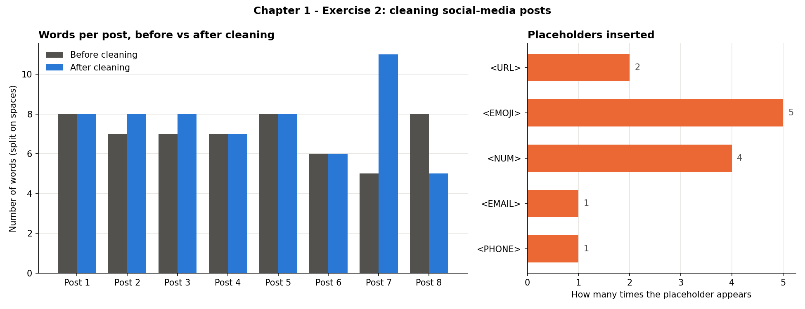

# Chapter 1 – Exercise 2: Regular Expressions on Social Media

[⬅ Back to the chapter](../README.md) · [🏠 Main page](../../README.md)

📄 **Exercise sheet:** [Exercise_2-Regular Expressions - Social Media.docx](Exercise_2-Regular%20Expressions%20-%20Social%20Media.docx)

## Goal

Turn 8 messy social-media posts (mentions, hashtags, emojis, slang, `happppyyyy`…) into clean text ready for NLP, using placeholders such as `<URL>`, `<EMOJI>`, `<NUM>`.

## Key ideas (for a junior)

* **Placeholders** – a model does not care *which* URL it was, only that there was one → `<URL>`.
* **The order of the steps matters** – e-mails before mentions (an e-mail contains `@`), URLs/phones/slang before numbers (they contain digits), `>>>` before `>>`.
* **Back-references** – `(\w)\1{2,}` = a letter repeated 3+ times; `r"\1\1"` puts it back twice.
* **Look-behind** – `(?<![\w.])@\w+` finds `@friend` but not the `@` inside an e-mail.
* **Regex limits** – a regex turns `happppyyyy` into `happyy`; only a dictionary/spell-checker knows it should be `happy`.

## What the script does

The script `ex2_regex_social_media.py` follows the exercise sheet step by step; every step is commented in the code.

| # | Task | How |
|---|---|---|
| 1 | Remove `RT @user:` | `^RT\s+@\w+:\s*` |
| 2 | Extract mentions | `findall` → column `mentions` |
| 3 | Extract hashtags | `findall` → column `hashtags` |
| 4 | Hashtag → word | `#(\w+)` → `\1` |
| 5 | URLs → `<URL>` | `https?://\S+` |
| 6 | Emojis → `<EMOJI>` | Unicode emoji blocks |
| 7 | Elongated words | `(\w)\1{2,}` → `\1\1` + small dictionary |
| 8 | Numbers → `<NUM>` | `100°F`, `$35,000`, `1st` |
| 9 | E-mails → `<EMAIL>` |  |
| 10 | Phones → `<PHONE>` | `+44 20 7946 0958` |
| 11 | Expand slang | ur, 4, 2moro, cu, lol, wtf |
| 12 | Expand `>>>` `>>` `<<` |  |
| 13 | Capitalised words | `\b[A-Z]{2,}\b` → NYC, WTF… |
| 14 | Word count after cleaning | column `word_count` |
| 15 | Final cleaned post | column `cleaned_post` |

## How to run

In a terminal (Command Prompt, PowerShell or the VS Code terminal):

```bash
cd "Chapter 1 - Introduction to NLP and Text Preprocessing/Exercise 2 - Regular Expressions - Social Media"
python ex2_regex_social_media.py
```
You can also run it from any other folder: the script always finds its data and writes
into its own `outputs/` folder.  First time? Run `setup_environment.bat` in the main folder.

## Results

| Original | Cleaned |
|---|---|
| `RT @user123: LOL!!! Can't believe it... 😂😂 http://bit.ly/3xYzQe` | `laughing out loud can't believe it <EMOJI> <URL>` |
| `Sooo happppyyyyy to get 1st placeeeee!!! 🏆🏆` | `so happy to get <NUM> place <EMOJI>` |
| `@friend Thanks 4 ur help!!! cu 2moro ;)` | `friend thanks for your help see you tomorrow` |
| `WTF??? Java >>> Python?????!! lololol` | `what the heck java much greater than python laughing out loud` |
| `Contact me: email_me@domain.co.uk OR +44 20 7946 0958` | `contact me <EMAIL> or <PHONE>` |



## Common mistakes

* Replacing numbers before phones/URLs → `<PHONE>` becomes `+<NUM> <NUM> <NUM>`.
* Replacing `>>` before `>>>` → `>>>` becomes "greater than >".
* `\b4\b` is needed so the `4` inside `iPhone14` is not turned into "for".

## Files

- `Exercise_2-Regular Expressions - Social Media.docx` – the exercise sheet (from Moodle)
- `ex2_regex_social_media.py` – the solution, with comments
- `outputs/` – created by the script:
  - ex2_cleaned_posts.csv
  - ex2_cleaning_overview.png
