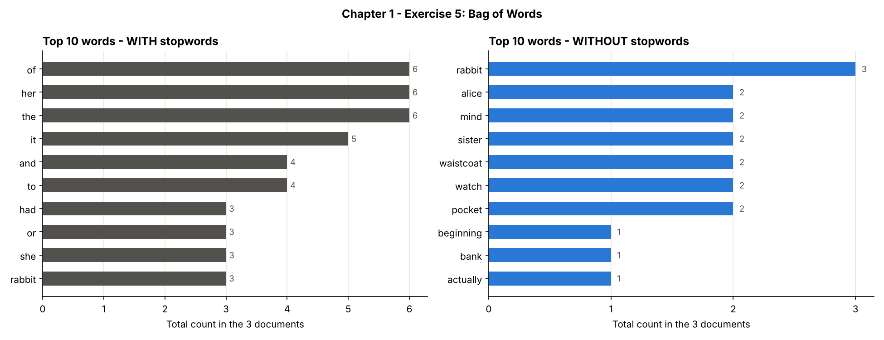
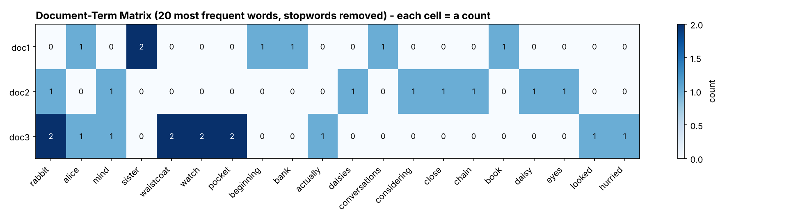

# Chapter 1 – Exercise 5: Bag of Words

[⬅ Back to the chapter](../README.md) · [🏠 Main page](../../README.md)

📄 **Exercise sheet:** [Exercise_5-BOW.docx](Exercise_5-BOW.docx)

## Goal

Read three passages of *Alice's Adventures in Wonderland*, build a Document-Term Matrix with `CountVectorizer`, show it as a DataFrame and find the most frequent words, with and without stopwords.

## Key ideas (for a junior)

* **Bag of Words** – text → numbers by *counting* words. The order of the words is lost ("dog bites man" = "man bites dog").
* **Vocabulary** – all the different words of all documents (`fit`).
* **Document-Term Matrix (DTM)** – rows = documents, columns = words, values = counts (`transform`).
* **Sparse matrix** – most cells are 0, so scikit-learn stores only the non-zero ones; `.toarray()` makes a normal table.

## What the script does

The script `ex5_bag_of_words.py` follows the exercise sheet step by step; every step is commented in the code.

| # | Task | How |
|---|---|---|
| 1 | Read the 3 documents | `open(..., encoding='utf-8')` |
| 2 | CountVectorizer → DTM | `fit_transform` |
| 3 | DTM as a pandas DataFrame | `pd.DataFrame(dtm.toarray(), columns=get_feature_names_out())` |
| 4 | Top 10 words | `dtm.sum(axis=0).sort_values()` |
| 5 | Bonus: without stopwords | `stop_words='english'` |

## How to run

In a terminal (Command Prompt, PowerShell or the VS Code terminal):

```bash
cd "Chapter 1 - Introduction to NLP and Text Preprocessing/Exercise 5 - Bag of Words"
python ex5_bag_of_words.py
```
You can also run it from any other folder: the script always finds its data and writes
into its own `outputs/` folder.  First time? Run `setup_environment.bat` in the main folder.

## Results

* 82 different words with stopwords → **42** without.
* Top 10 **with** stopwords: *of, her, the* (6 each), *it* (5), *and, to* (4) … – nine of the ten are grammar words, only *rabbit* is meaningful.
* Top 10 **without** stopwords: *rabbit* (3), *alice, mind, sister, waistcoat, watch, pocket* (2) – now we see what the story is about.





## Common mistakes

* Mixing test sentences ("The cat sat on the mat") with the real documents.
* Adding n-grams (`ngram_range=(1,3)`) without being asked: the matrix explodes and the top 10 changes.
* Running the script from another folder and getting "file not found" (the script now uses its own folder).

## Files

- `Exercise_5-BOW.docx` – the exercise sheet (from Moodle)
- `ex5_bag_of_words.py` – the solution, with comments
- `outputs/` – created by the script:
  - ex5_dtm.csv, ex5_dtm_no_stopwords.csv
  - ex5_top_words.png
  - ex5_dtm_heatmap.png
