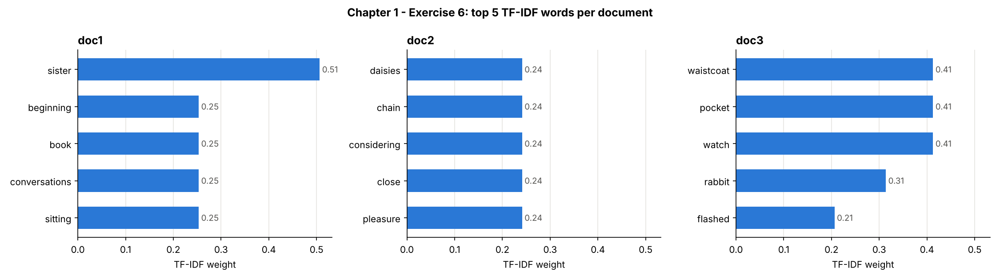
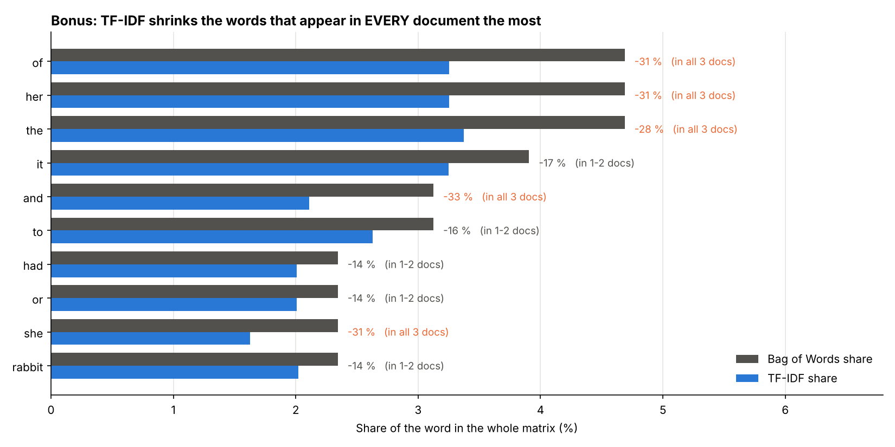

# Chapter 1 – Exercise 6: TF-IDF

[⬅ Back to the chapter](../README.md) · [🏠 Main page](../../README.md)

📄 **Exercise sheet:** [Exercise_6-TF-IDF.docx](Exercise_6-TF-IDF.docx)

## Goal

Analyse the same three Alice passages with `TfidfVectorizer`, find the 5 most characteristic words of each document and compare with Bag of Words.

## Key ideas (for a junior)

* **TF** (term frequency) – how often the word appears *in this document*.
* **IDF** (inverse document frequency) – how *rare* the word is across documents: `idf = ln((1+n)/(1+df)) + 1`.
* **TF-IDF = TF × IDF** – high for words typical of one document, low for words found everywhere.
* **L2 normalisation** – every row is scaled to length 1, so long and short documents are comparable.
* **IDF needs many documents** – with only 3 documents IDF goes from 1.00 to 1.69: not enough to stop *the* from winning, so we also remove stopwords.

## What the script does

The script `ex6_tfidf.py` follows the exercise sheet step by step; every step is commented in the code.

| # | Task | How |
|---|---|---|
| 1 | Read the 3 documents | one list created **before** the loop |
| 2 | TfidfVectorizer → TF-IDF matrix |  |
| 3 | DataFrame | rows = docs, columns = words |
| 4 | Top 5 words per document |  |
| 5 | Bonus: compare with Bag of Words | frequent-but-low-TF-IDF words vs unique words |

## How to run

In a terminal (Command Prompt, PowerShell or the VS Code terminal):

```bash
cd "Chapter 1 - Introduction to NLP and Text Preprocessing/Exercise 6 -TF-IDF"
python ex6_tfidf.py
```
You can also run it from any other folder: the script always finds its data and writes
into its own `outputs/` folder.  First time? Run `setup_environment.bat` in the main folder.

## Results

| Document | Top 5 TF-IDF words |
|---|---|
| doc1 | sister (0.51), beginning, book, conversations, sitting (0.25) |
| doc2 | daisies, chain, considering, close, pleasure (0.24 – a tie: all appear once, only here) |
| doc3 | waistcoat, pocket, watch (0.41), rabbit (0.31), flashed (0.21) |

**Bonus:** *and, her, of, she, the* appear in all three documents (IDF = 1.00, the minimum). Compared with Bag of Words their share of the matrix drops by about 30 %, while *waistcoat, watch, pocket, sister* – frequent in **one** document only – are pushed to the top.





## Common mistakes

* `docs = []` **inside** the loop → only the last file is kept (a 1-document TF-IDF is useless).
* Expecting TF-IDF to remove stopwords by itself on a tiny corpus.

## Files

- `Exercise_6-TF-IDF.docx` – the exercise sheet (from Moodle)
- `ex6_tfidf.py` – the solution, with comments
- `outputs/` – created by the script:
  - ex6_tfidf_matrix.csv
  - ex6_top5_per_document.png
  - ex6_bow_vs_tfidf.png
