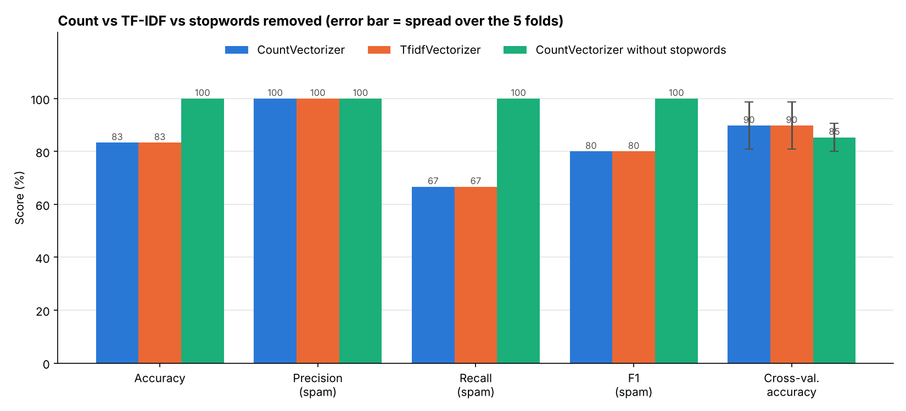
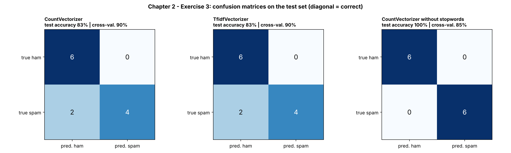
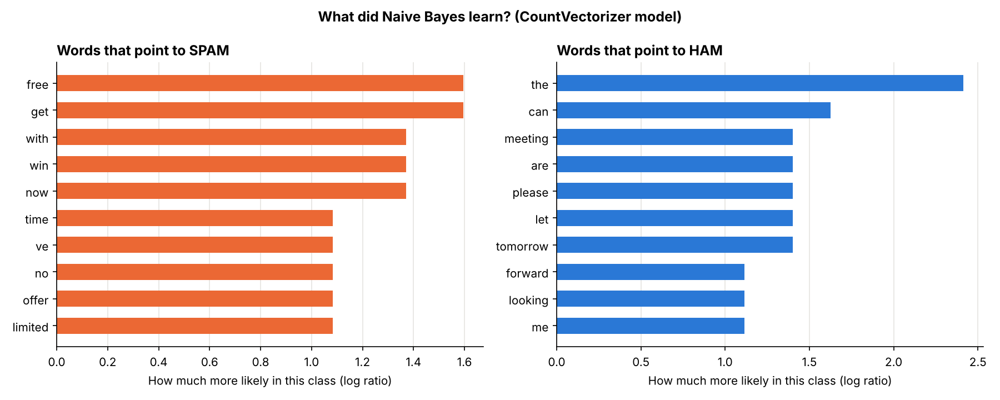

# Chapter 2 – Exercise 3: Spam Classification with Naive Bayes

[⬅ Back to the chapter](../README.md) · [🏠 Main page](../../README.md)

📄 **Exercise sheet:** [Exercise_3-Bayes Spam Classification.docx](Exercise_3-Bayes%20Spam%20Classification.docx)

## Goal

Train a Multinomial Naive Bayes classifier that detects spam e-mails, evaluate it on unseen e-mails and with cross-validation, and compare `CountVectorizer` with `TfidfVectorizer`.

## Key ideas (for a junior)

* **Supervised learning** – the model learns from labelled examples (spam / ham).
* **Train / test split** – learn on one part, evaluate on e-mails the model has **never seen**.
* **Pipeline** – `make_pipeline(vectorizer, model)` guarantees the vocabulary is learned on the training set only.
* **Naive Bayes** – counts how often each word appears in each class; *naive* = it assumes words are independent.
* **Precision / recall / F1** – precision = "of the e-mails flagged as spam, how many were spam?"; recall = "of all spam, how much did we catch?".
* **Cross-validation** – 48 e-mails → a test set of 12: one split is luck. 5-fold CV tests on every part and averages.

## What the script does

The script `ex3_spam_naive_bayes.py` follows the exercise sheet step by step; every step is commented in the code.

| # | Task | How |
|---|---|---|
| 1 | Load the CSV |  |
| 2 | CountVectorizer | inside a pipeline |
| 3 | train_test_split (+ cross-validation) | stratified, 25 % test, 5 folds |
| 4 | Train and test Naive Bayes | `MultinomialNB(alpha=1)` |
| 5 | Measure the performance | classification report, confusion matrix |
| 6 | Challenge: TfidfVectorizer | side-by-side comparison |
| 7 | Extra: remove stopwords? | a third model |

## How to run

In a terminal (Command Prompt, PowerShell or the VS Code terminal):

```bash
cd "Chapter 2 - Traditional NLP/Exercise 3 - Spam classification"
python ex3_spam_naive_bayes.py
```
You can also run it from any other folder: the script always finds its data and writes
into its own `outputs/` folder.  First time? Run `setup_environment.bat` in the main folder.

## Results

| Model | Test split accuracy (12 e-mails) | 5-fold cross-validation |
|---|---|---|
| CountVectorizer | 83 % | **90 %** |
| TfidfVectorizer | 83 % | **90 %** |
| CountVectorizer **without** stopwords | 100 % | 85 % |

Two lessons: Count and TF-IDF are equal on such short texts, and **removing stopwords hurts** (*you, your, now* are typical spam words). Notice that the single split says the opposite of cross-validation – that is exactly why we cross-validate.







## Common mistakes

* Vectorizing **all** e-mails before splitting: the test words leak into the vocabulary.
* Judging the model on one tiny test split.
* Removing stopwords "because it is always done".

## Files

- `Exercise_3-Bayes Spam Classification.docx` – the exercise sheet (from Moodle)
- `ex3_spam_naive_bayes.py` – the solution, with comments
- `outputs/` – created by the script:
  - ex3_confusion_matrices.png
  - ex3_count_vs_tfidf.png
  - ex3_top_words.png
