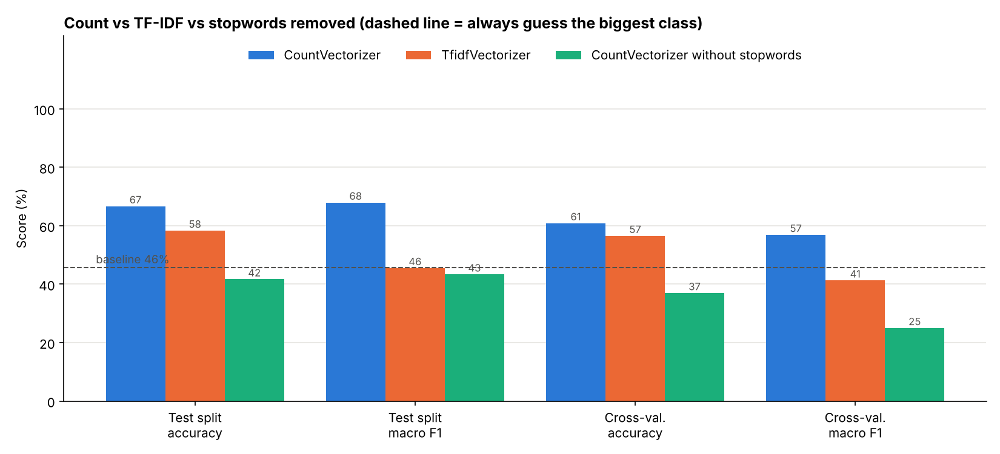
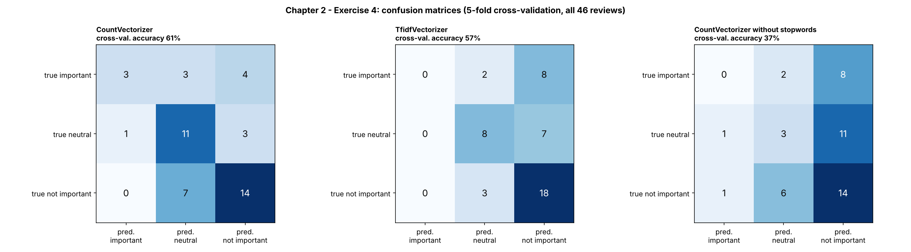
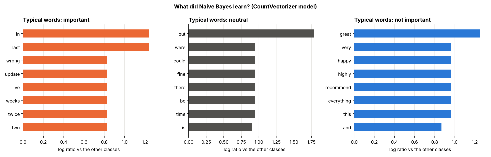

# Chapter 2 – Exercise 4: Customer Reviews (important / neutral / not important)

[⬅ Back to the chapter](../README.md) · [🏠 Main page](../../README.md)

📄 **Exercise sheet:** [Exercise_4-Bayes Customer Review.docx](Exercise_4-Bayes%20Customer%20Review.docx)

## Goal

Train a Naive Bayes classifier that sorts customer reviews into three classes, so that the important complaints can be answered first.

## Key ideas (for a junior)

* **Multi-class** – the same Naive Bayes, with 3 probabilities instead of 2.
* **Macro average** – the mean of the per-class scores: the small *important* class counts as much as the others.
* **Baseline** – always predicting the biggest class (*not important*, 21/46) already gives **46 %**. A model must beat it.
* **Stopwords can carry meaning** – *but, not, no* are in the English stopword list, yet they are what makes a review *neutral* ("nice, **but** slow").

## What the script does

The script `ex4_reviews_naive_bayes.py` follows the exercise sheet step by step; every step is commented in the code.

| # | Task | How |
|---|---|---|
| 1 | Load the CSV |  |
| 2 | CountVectorizer |  |
| 3 | Split + cross-validation | `cross_val_predict` over all 46 reviews |
| 4 | Train and test Naive Bayes |  |
| 5 | Measure the performance | per class + macro F1, 3×3 confusion matrix |
| 6 | Challenge: TfidfVectorizer |  |
| 7 | Extra: remove stopwords? | a third model |

## How to run

In a terminal (Command Prompt, PowerShell or the VS Code terminal):

```bash
cd "Chapter 2 - Traditional NLP/Exercise 4 - Customer Reviews"
python ex4_reviews_naive_bayes.py
```
You can also run it from any other folder: the script always finds its data and writes
into its own `outputs/` folder.  First time? Run `setup_environment.bat` in the main folder.

## Results

| Model | Cross-validated accuracy | Macro F1 |
|---|---|---|
| Baseline (always "not important") | 46 % | – |
| CountVectorizer | **61 %** | 57 % |
| TfidfVectorizer | 57 % | 41 % |
| CountVectorizer **without** stopwords | 37 % (worse than the baseline!) | 25 % |

With only 46 one-sentence reviews the task is hard, but the main lesson is clear: **test before you remove stopwords**.







## Common mistakes

* Reporting only the accuracy on unbalanced classes – always compare with the baseline.
* Using `pos_label` metrics as in Exercise 3: with 3 classes use `average="macro"`.

## Files

- `Exercise_4-Bayes Customer Review.docx` – the exercise sheet (from Moodle)
- `ex4_reviews_naive_bayes.py` – the solution, with comments
- `outputs/` – created by the script:
  - ex4_confusion_matrices.png
  - ex4_count_vs_tfidf.png
  - ex4_top_words_per_class.png
