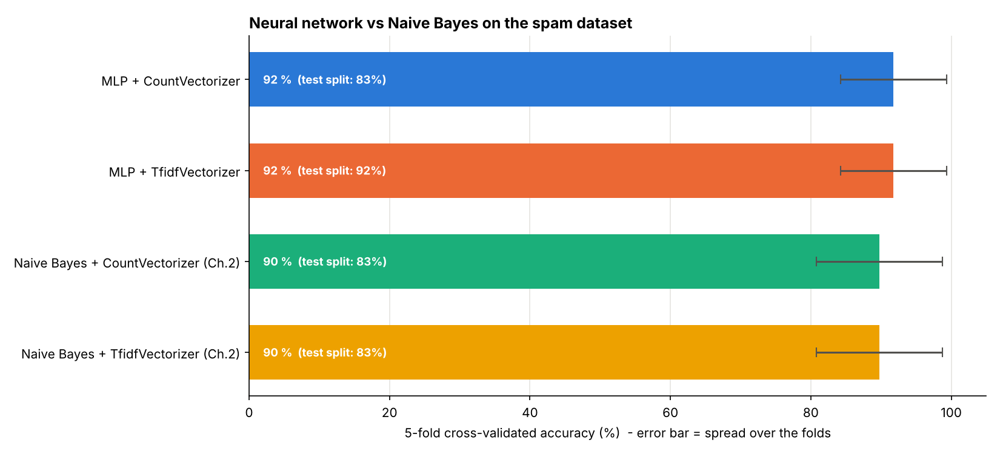
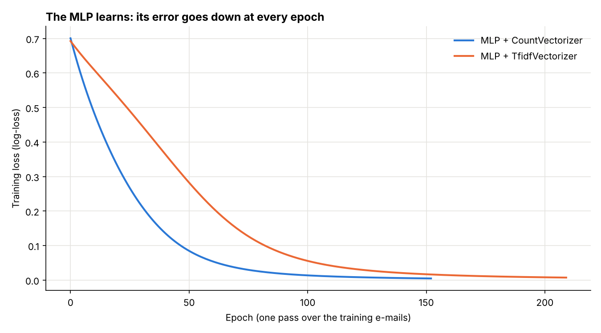
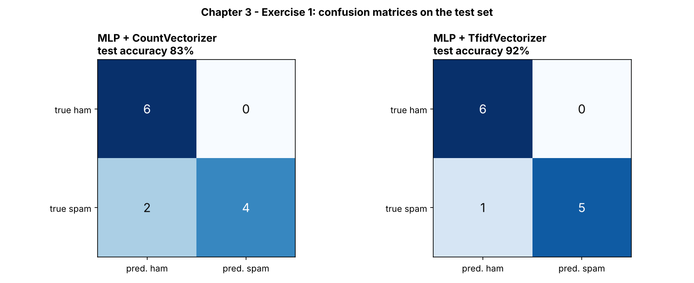

# Chapter 3 – Exercise 1: Spam Classification with a Neural Network (MLP)

[⬅ Back to the chapter](../README.md) · [🏠 Main page](../../README.md)

📄 **Exercise sheet:** [Exercise_1-Spam Classification.docx](Exercise_1-Spam%20Classification.docx)

## Goal

Solve the spam problem of Chapter 2 again, this time with a Multi-Layer Perceptron, compare CountVectorizer with TF-IDF, and compare the network with Naive Bayes.

## Key ideas (for a junior)

* **MLP** – input layer (one neuron per word) → hidden layer(s) → output. Each connection has a **weight**.
* **Neuron** – `activation(sum(input × weight) + bias)`; `relu` or `logistic` (sigmoid).
* **Training** – the weights are adjusted epoch after epoch so that the **loss** (error) goes down.
* **Overfitting** – 48 e-mails but ~19,000 weights: the network can learn the training set by heart.
* **Right tool for the data** – on tiny data Naive Bayes is just as good, faster and easier to explain.

## What the script does

The script `ex1_spam_mlp.py` follows the exercise sheet step by step; every step is commented in the code.

| # | Task | How |
|---|---|---|
| 1 | Load the CSV |  |
| 2 | CountVectorizer |  |
| 3 | Split + cross-validation |  |
| 4 | Train and test an MLP | `MLPClassifier(hidden_layer_sizes=(100,))` |
| 5 | Measure the performance |  |
| 6 | Challenge: TfidfVectorizer | + comparison with Naive Bayes |

## How to run

In a terminal (Command Prompt, PowerShell or the VS Code terminal):

```bash
cd "Chapter 3 - Neural Networks/Exercise 1 - Spam Classification"
python ex1_spam_mlp.py
```
You can also run it from any other folder: the script always finds its data and writes
into its own `outputs/` folder.  First time? Run `setup_environment.bat` in the main folder.

## Results

| Model | Test split (12 e-mails) | 5-fold cross-validation |
|---|---|---|
| MLP + CountVectorizer | 83 % | 92 % |
| MLP + TfidfVectorizer | 92 % | 92 % |
| Naive Bayes + Count (Ch. 2) | 83 % | 90 % |
| Naive Bayes + TF-IDF (Ch. 2) | 83 % | 90 % |

Practically a draw: the network (19,301 weights) brings no real gain on 48 e-mails.







## Common mistakes

* Calling `nn.fit(X, y)` before creating `X` and `y` (load + vectorize first).
* `predict(X)` on the training data = no real evaluation.

## Files

- `Exercise_1-Spam Classification.docx` – the exercise sheet (from Moodle)
- `ex1_spam_mlp.py` – the solution, with comments
- `outputs/` – created by the script:
  - ex1_loss_curves.png
  - ex1_confusion_matrices.png
  - ex1_models_comparison.png
