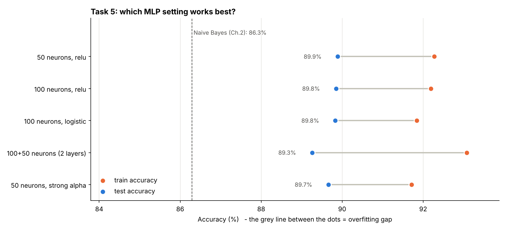
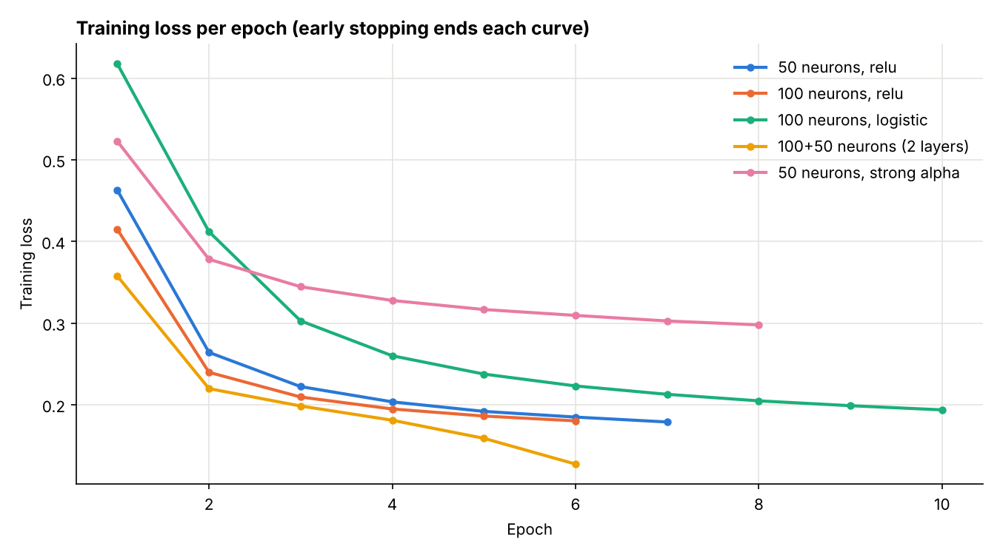
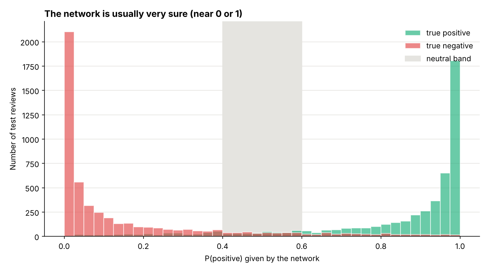
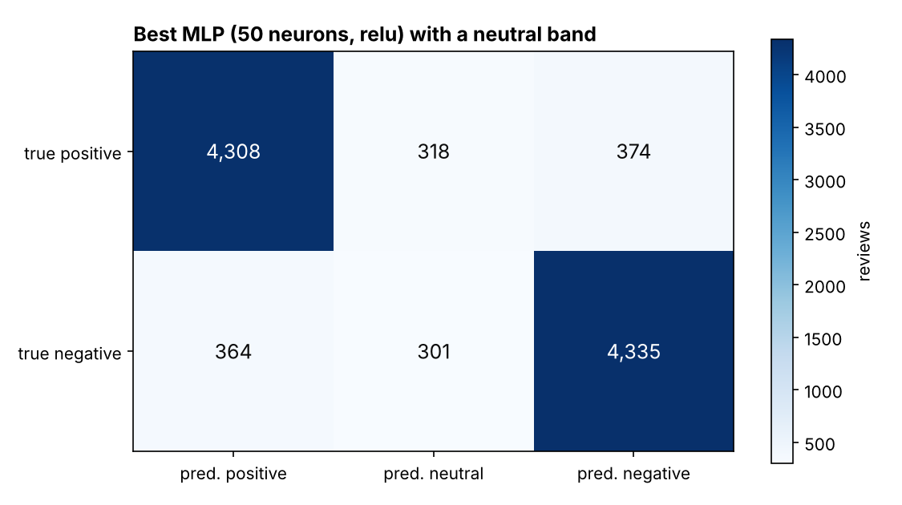

# Chapter 3 – Exercise 2: IMDB Sentiment Analysis with Neural Networks

[⬅ Back to the chapter](../README.md) · [🏠 Main page](../../README.md)

📄 **Exercise sheet:** [Exercise_2-Sentiment Analysis-IMDB.docx](Exercise_2-Sentiment%20Analysis-IMDB.docx)

## Goal

Clean the 50,000 IMDB reviews, turn them into a TF-IDF matrix, classify them with MLPs using different parameters, and add a *neutral* class from the network's confidence.

## Key ideas (for a junior)

* **Hyper-parameters** – settings chosen before training: number of neurons/layers, activation, `alpha` (regularisation).
* **Early stopping** – 10 % of the training data is kept aside; training stops when it no longer improves.
* **Overfitting gap** – train accuracy − test accuracy.
* **More data = less overfitting** – the gap is ~8 % with 10,000 reviews and ~2.5 % with 50,000.
* **Neutral from probabilities** – IMDB has 2 classes, but `predict_proba` says how sure the network is: 0.4 < P(positive) < 0.6 → *neutral*.
* **Bigrams + kept stopwords** – `not good` is a feature; removing *not* would destroy it.

## What the script does

The script `ex2_imdb_mlp.py` follows the exercise sheet step by step; every step is commented in the code.

| # | Task | How |
|---|---|---|
| 1 | Load the CSV | from `../../data/` |
| 2 | Remove HTML tags |  |
| 3 | TF-IDF document-term matrix | 5,000 features, words + word pairs |
| 4 | Classify positive / negative / neutral with an MLP | neutral = unsure band |
| 5 | Different MLP parameters | 5 settings + Naive Bayes reference |

## How to run

In a terminal (Command Prompt, PowerShell or the VS Code terminal):

```bash
cd "Chapter 3 - Neural Networks/Exercise 2 - IMDB Sentiment Analysis"
python ex2_imdb_mlp.py
```
You can also run it from any other folder: the script always finds its data and writes
into its own `outputs/` folder.  First time? Run `setup_environment.bat` in the main folder.

## Results

Full dataset (40,000 training / 10,000 test reviews), about 1.5 minutes:

| Setting | Train acc. | Test acc. | Gap |
|---|---|---|---|
| 50 neurons, relu | 92.3 % | **89.9 %** | 2.4 % |
| 100 neurons, relu | 92.2 % | 89.9 % | 2.3 % |
| 100 neurons, logistic | 91.8 % | 89.8 % | 2.0 % |
| 100+50 neurons (2 layers) | 93.1 % | 89.3 % | 3.8 % |
| 50 neurons, strong alpha | 91.7 % | 89.7 % | 2.1 % |
| *Naive Bayes (reference)* | | *86.3 %* | |

* All networks are within 0.6 % of each other: the **data** matters more than the exact network size, and the biggest network is *not* the best.
* With a neutral band, 6 % of the reviews are "unsure"; on the others the accuracy rises to **92 %**, and the unsure ones are close to a coin flip (56 %).
* With `--sample 10000` the best test accuracy drops to ~87.6 % and the overfitting gap grows to 7–10 %.









## Common mistakes

* Fitting the TF-IDF on all reviews before splitting (test data leaks into the vocabulary).
* Training for hundreds of epochs without early stopping on 40,000 reviews: slow and overfits.

## Files

- `Exercise_2-Sentiment Analysis-IMDB.docx` – the exercise sheet (from Moodle)
- `ex2_imdb_mlp.py` – the solution, with comments
- `outputs/` – created by the script:
  - ex2_results.csv
  - ex2_mlp_parameters.png
  - ex2_loss_curves.png
  - ex2_confusion_matrix.png
  - ex2_probability_histogram.png
